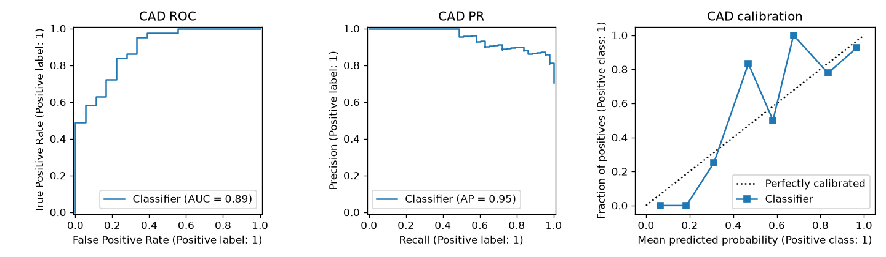
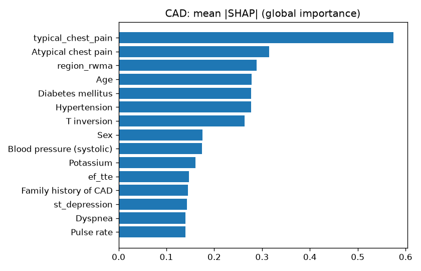
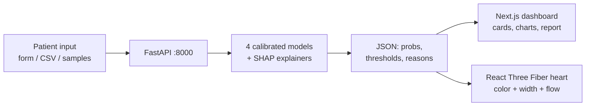

# VesselVision

VesselVision predicts coronary artery disease and LAD, LCX and RCA stenosis risk from clinical data, then colors an interactive 3D heart by risk, with SHAP explanations for every prediction.

[](backend/pyproject.toml)
[](frontend/package.json)
[](backend/pyproject.toml)
[](frontend/package.json)
[](LICENSE)

## Hackathon

Multimodal AI Hackathon 2026 (KamandPrompt, IIT Mandi) — **Track A: Cardiovascular Risk Visualization & Prediction**.

- Team: TODO_TEAM_NAME — members: TODO_MEMBER_1, TODO_MEMBER_2 (, TODO_MEMBER_3)
- Demo video (3–10 min, YouTube): TODO_YOUTUBE_URL
- Live demo: TODO_LIVE_URL (or "run locally", see below)
- Devpost page: TODO_DEVPOST_URL

## Screenshots

App captures (take before submission, save under `docs/screenshots/`):

1. `01-form.png` — filled patient form with normal-range hints
2. `02-heart.png` — 3D heart recolored by risk, artery chip selected
3. `03-shap.png` — reasons panel with diverging bars
4. `04-mobile.png` — stacked mobile flow at 390px width

Measured figures already in the repo:




## Problem and solution

A bare number — "72% heart-disease risk" — doesn't show **where** in the heart the problem is or **why** the model thinks so. Angiography answers those questions late and invasively.

VesselVision turns 54 routine clinical fields (demographics, symptoms, ECG, labs, echo) into per-artery stenosis risk you can see: a 3D heart whose LAD, LCX and RCA recolor green → amber → red, narrow with risk, beat at the patient's pulse and stream blood at their flow — with plain-word reasons, accuracy bands and a printable multilingual report for every result.

## Features

### Predictive modeling

- CAD plus LAD, LCX, RCA stenosis from 54 clinical inputs; calibrated probabilities, per-target decide lines (0.40 / 0.45 / 0.20 / 0.17).
- Leakage blocked by design: `LAD, LCX, RCA, Cath, CAD` are never input features (fail-loud guard + `tests/test_leakage.py`).
- Winners by CV ROC-AUC: CAD logreg_smote (.935), LAD rf_smote (.860), LCX xgb (.747), RCA lgbm (.738); honest ± bands from the folds served at `GET /uncertainty`.

### 3D visual mapping

- Interactive heart: drag-rotate, scroll-zoom, click/hover/keyboard vessel selection, Front/Back/Reset presets.
- Arteries recolor **green <30% · amber 30–70% · red >70%**, thin with rising risk, flash on new scores; fullscreen theatre with dark stage, zoom/spin/muscle-fade/label controls.
- Living data: beat follows pulse (PR), flow follows pulse × ejection fraction, white cells follow WBC, red tint follows hemoglobin, flow slows in tight arteries.

### Clinical dashboard

- Overall + per-vessel probabilities, "How sure is this?" bands, SHAP top-10 diverging bars, measurements vs normal ranges with raise/lower signals, what-if (−50…+50% sliders), model-performance tab, printable report (EN/HI/ES/FR/DE/PT/IT/NL/RU/ID), CSV template + sample file + batch scoring, checkup history with trend chart (optional Neon Postgres).

### 3D models used

- Myocardium: `frontend/public/models/heart.glb` (3.0 MB). Author/license: TODO — confirm from the source page into `frontend/public/models/CREDITS.md` before submission.
- Arteries: procedural tube meshes from one shared config (`frontend/src/lib/arteries.ts`).

### Safety disclaimer

Always visible in the UI: "For decision support and educational purposes only. Not a substitute for formal diagnostic imaging or clinical judgment."

### Requirement checklist

| Track A requirement | Where | Status |
|---|---|---|
| CAD + per-artery prediction, no leakage | `POST /predict`, `backend/app/features.py`, `tests/test_leakage.py` | Done |
| Interactive 3D heart, color by probability | `frontend/src/components/heart/`, Theatre mode | Done |
| Rotate / zoom / select vessels | OrbitControls, presets, chips, keyboard buttons | Done |
| Explainable predictions | `POST /explain`, ShapPanel, MeasurementsTable | Done |
| Clinical dashboard + measurements | Results column, PerformanceTab | Done |
| What-if analysis | WhatIf sliders + theatre levers | Done |
| Report export | ReportTab (print/PDF, 10 languages) | Done |
| Batch CSV scoring | `POST /predict-batch`, CsvUpload Score-all | Done |
| Uncertainty display | `GET /uncertainty`, UncertaintyPanel | Done |
| History + trend | `*/history`, HistoryTab (needs `DATABASE_URL`) | Done (degrades honestly without DB) |
| Demo video / screenshots | — | TODO (capture pre-submission) |

## Architecture



- **Backend** (`backend/`, Python 3.12, uv): `main.py` + `app/` modules. Models load once at startup; stateless requests; uploads parsed in memory (2 MB / 200-row caps), never stored.
- **Frontend** (`frontend/`, Next.js App Router + TypeScript + Tailwind, bun): schema-driven form, R3F heart, Recharts dashboard, one shared prediction driver (400 ms debounce, stale-response guards).
- **Data** (`data/`): raw vendored xlsx + `processed/clean.csv` + `feature_schema.json` (the form's single source of truth).

```
vesselvision/
  backend/          FastAPI: main.py + app/ (api, data, train, predict, explain, ...)
  backend/artifacts/  *_model.joblib + metrics.json + thresholds.json + cv_results.csv
  backend/tests/    pytest: api, leakage, shap-additivity, smoke (21 tests)
  frontend/         Next.js App Router + TS + Tailwind (bun)
  frontend/src/components/heart/  R3F scene: canvas, tree, labels, live effects, theatre
  frontend/src/components/dashboard/  summary, vessels, SHAP, what-if, scores, report, history
  frontend/src/locales/  report strings: en hi es fr de pt it nl ru id
  frontend/public/models/heart.glb  myocardium mesh
  data/             raw xlsx (vendored) + processed/clean.csv + feature_schema.json
  notebooks/        01_eda.ipynb, 02_training.ipynb
  docs/             documentation + figures/ + ROADMAP.md
```

## Dataset

Extension of the Z-Alizadeh Sani dataset — **UCI ML Repository ID 411** (note: not 484),
303 patients × 59 columns, CC BY 4.0, DOI 10.24432/C5461K. Citation: Alizadehsani, R.,
Roshanzamir, M., & Sani, Z. (2013), UCI Machine Learning Repository. Also mirrored at
Mendeley Data DOI 10.17632/bgf5czvpg2.1.

- Obtain: vendored at `data/raw/` (xlsx + original zip). `fetch_ucirepo(id=411)` does
  **not** work (xlsx-only release), so the file ships with the repo — see `data/README.md`.
- Targets: `Cath` (angiography result → overall CAD label, 216 CAD / 87 Normal),
  `LAD` / `LCX` / `RCA` per-artery stenosis labels.
- Preprocessing (`backend/app/data.py`, inside sklearn Pipelines fitted on training folds
  only): column-name normalization, `Fmale` typo → Female, Y/N → 1/0, BBB 3-level,
  VHD ordinal 0–3, constant `Exertional CP` dropped, deterministic `clean.csv`.

## Target leakage prevention

`LAD`, `LCX`, `RCA`, `Cath` and `CAD` are excluded from inputs — enforced three ways:

1. `backend/app/features.py`: same 54 leakage-free columns for every target, matched
   case-insensitively, fail-loud if the denylist finds nothing (schema drift alarm).
2. `POST /predict` rejects leakage keys first with 422 (`FORBIDDEN_INPUTS`).
3. `tests/test_leakage.py`: `test_no_leakage_columns_per_target`,
   `test_preprocessor_output_has_no_leakage`, `test_unknown_target_raises`.

Final feature count: **54** (`len(feature_schema.json["features"])`).

## Models and evaluation

CV: stratified repeated 5-fold × 3, seed 42, 24 arms (6 model families × 4 targets);
SMOTE variants train inside folds only (comparison arms). Winner per target = best mean
ROC-AUC.

| Target | Winner | Acc | Prec | Rec | F1 | AUC |
|---|---|---|---|---|---|---|
| CAD | logreg_smote | .881±.024 | .945±.025 | .886±.039 | .914±.019 | **.935±.025** |
| LAD | rf_smote | .796±.037 | .806±.044 | .863±.059 | .831±.031 | **.860±.048** |
| LCX | xgb | .694±.055 | .623±.082 | .572±.086 | .594±.075 | **.747±.069** |
| RCA | lgbm | .676±.045 | .568±.068 | .614±.117 | .584±.068 | **.738±.058** |

<details><summary>Full 24-row CV table (all families)</summary>

| Target | Model | Acc | Prec | Rec | F1 | AUC |
|---|---|---|---|---|---|---|
| CAD | logreg | .868±.027 | .949±.031 | .863±.044 | .903±.022 | .933±.025 |
| CAD | logreg_smote | .881±.024 | .945±.025 | .886±.038 | .914±.019 | .935±.025 |
| CAD | rf | .866±.044 | .920±.040 | .891±.038 | .904±.031 | .928±.032 |
| CAD | rf_smote | .868±.041 | .900±.033 | .918±.035 | .908±.028 | .931±.025 |
| CAD | xgb | .878±.042 | .924±.042 | .904±.032 | .914±.028 | .919±.038 |
| CAD | lgbm | .855±.045 | .921±.040 | .872±.042 | .895±.032 | .917±.041 |
| LAD | logreg | .749±.032 | .801±.038 | .763±.053 | .780±.030 | .841±.052 |
| LAD | logreg_smote | .749±.038 | .801±.044 | .763±.043 | .780±.032 | .841±.052 |
| LAD | rf | .790±.043 | .806±.048 | .850±.059 | .825±.035 | .858±.049 |
| LAD | rf_smote | .796±.037 | .806±.044 | .863±.059 | .831±.031 | .860±.048 |
| LAD | xgb | .772±.047 | .802±.049 | .814±.063 | .806±.042 | .837±.054 |
| LAD | lgbm | .751±.042 | .802±.052 | .770±.075 | .782±.040 | .828±.052 |
| LCX | logreg | .638±.062 | .534±.070 | .621±.099 | .573±.078 | .689±.073 |
| LCX | logreg_smote | .634±.059 | .531±.071 | .599±.106 | .560±.078 | .682±.074 |
| LCX | rf | .681±.054 | .589±.075 | .653±.061 | .617±.058 | .733±.069 |
| LCX | rf_smote | .683±.052 | .605±.083 | .602±.104 | .597±.068 | .737±.068 |
| LCX | xgb | .694±.055 | .623±.082 | .572±.086 | .594±.075 | .747±.069 |
| LCX | lgbm | .693±.045 | .611±.059 | .608±.065 | .609±.058 | .744±.068 |
| RCA | logreg | .665±.046 | .550±.059 | .661±.107 | .595±.057 | .733±.034 |
| RCA | logreg_smote | .650±.042 | .535±.059 | .640±.115 | .576±.058 | .724±.033 |
| RCA | rf | .672±.052 | .561±.072 | .620±.112 | .584±.076 | .729±.045 |
| RCA | rf_smote | .669±.041 | .571±.073 | .550±.092 | .553±.054 | .731±.043 |
| RCA | xgb | .658±.053 | .549±.079 | .585±.122 | .559±.078 | .719±.051 |
| RCA | lgbm | .676±.045 | .568±.068 | .614±.117 | .584±.068 | .738±0.058 |

Source: `backend/artifacts/cv_results.csv` (24 rows).
</details>

Held-out stratified 20% test (n=61, seed 42, never tuned on):

| Target | Model | Acc | Prec | Rec | F1 | AUC | Brier | Calib | Thr | Confusion [[TN FP],[FN TP]] |
|---|---|---|---|---|---|---|---|---|---|---|
| CAD | logreg_smote | .869 | .857 | .977 | .913 | .889 | .117 | sigmoid | 0.40 | [[11 7],[1 42]] |
| LAD | rf_smote | .820 | .791 | .944 | .861 | .838 | .158 | sigmoid | 0.45 | [[16 9],[2 34]] |
| LCX | xgb | .623 | .512 | .917 | .657 | .737 | .207 | isotonic | 0.20 | [[16 21],[2 22]] |
| RCA | lgbm | .541 | .444 | .870 | .588 | .752 | .193 | none (won) | 0.17 | [[13 25],[3 20]] |

Thresholds maximize F1 on train-split out-of-fold predictions (an F2 variant degenerated
to catch-all cutoffs and was rejected). Calibration picked per target by Brier score.
Honest note: n=303 means wide intervals — vessel stds reach ±0.07 AUC and LCX/RCA
held-out accuracy is weak; the UI shows ± bands (`GET /uncertainty`) so no number
pretends to be exact. Full tables: `notebooks/02_training.ipynb`, `docs/figures/eval_*`.

## Explainability

Per-target SHAP explainers over the exact preprocessed features (Tree/Linear dispatch,
calibrated wrappers unwrapped; additivity test-enforced in `tests/test_shap_additivity.py`).
The UI shows top-10 diverging bars with measured values + units, a plain "Top driver … pushes
risk up/down" line, and per-measurement raise/lower signals. Global plots:
`docs/figures/shap_global_{cad,lad,lcx,rca}.png` (CAD: chest pain/atypical/RWMA;
LAD: chest pain/EF/RWMA; LCX: age/TG/chest pain; RCA: diabetes/age/chest pain).

## 3D visualization

- Myocardium: the open-license GLB above, rendered semi-transparent and auto-fit to the
  rig (any `heart.glb` centers exactly — no magic constants).
- Arteries: LAD/LCX/RCA are separate TubeGeometry meshes along paths in the single
  `ANATOMY_MAP`/`ARTERY_PATHS` config shared by API and frontend — model outputs map 1:1
  to colors. Whole-heart scans are fused meshes, so per-vessel recoloring needs these tubes.
- Data-driven life: beat at pulse rate, flow at pulse × ejection fraction, white cells
  from WBC, red tint from hemoglobin, slower flow in tight arteries; ± energy from CAD output.
- No-GPU friendly: no post-processing, pixel ratio capped [1, 1.5], memoized geometries,
  instant SVG/DOM overlays instead of 3D portals, error boundary + 2D fallback.
- Asset credit/license: TODO — confirm in `frontend/public/models/CREDITS.md`.

## API reference

| Method & path | Purpose | Needs models |
|---|---|---|
| `GET /health` | liveness `{status: ok}` | no |
| `GET /schema` | 54 field definitions driving the form | no |
| `GET /samples` | 6 example patients (labels stripped) | no |
| `POST /predict` | CAD + vessel probabilities, labels, thresholds | yes |
| `POST /explain` | SHAP top-10 for one target | yes |
| `POST /predict-batch` | CSV file in → per-row scores (in-memory only) | yes |
| `GET /metrics` | held-out scores per target | yes (file) |
| `GET /uncertainty` | ± bands per target from CV folds | yes (file) |
| `POST /history` | score + store a checkup (needs `DATABASE_URL`) | yes |
| `GET /history` | newest-first checkups | DB |
| `DELETE /history/{id}` | remove one checkup | DB |

Sample `POST /predict` (missing fields fall back to typical values):

```json
// request
{"inputs": {"age": 53, "sex": "Male", "bp": 140, "ldl": 190, "typical_chest_pain": 1}}
// response (verified live against the trained models)
{"cad": {"probability": 0.8082, "label": 1, "threshold": 0.4},
 "vessels": {"LAD": {"probability": 0.7596, "label": 1, "threshold": 0.45},
             "LCX": {"probability": 0.342, "label": 1, "threshold": 0.2},
             "RCA": {"probability": 0.4763, "label": 1, "threshold": 0.17}}}
```

## Setup and run

Prerequisites: Python 3.12 (via `uv`), Node 22 + `bun 1.4`, Git. Verified with uv 0.5.9, bun 1.4.0, node v22.

```bash
git clone TODO_REPO_URL && cd vesselvision

# backend (from backend/)
uv sync
cp .env.example .env   # add DATABASE_URL only if you want history (Neon)

# frontend (from frontend/)
bun install
cp .env.example .env.local  # point NEXT_PUBLIC_API_URL at the backend if needed
```

```bash
# run both at once (from repo root — recommended)
bun run all        # API :8000 + web :3000 in one terminal
# or separately:
make backend       # cd backend && uv run uvicorn main:app --port 8000 --reload
make frontend      # cd frontend && bun run dev
```

Health: `GET http://localhost:8000/health` → `{"status":"ok"}`. App: http://localhost:3000 → landing; console at `/console`.

Without uv/bun (judges): backend ships `requirements.txt` (`pip install -r backend/requirements.txt`, then `uvicorn main:app --port 8000` from `backend/`); frontend needs bun (`bun install`, `bun run dev`) — npm is not supported (bun lockfile + scripts).

Retrain + regenerate everything: `make train` (`cd backend && uv run python -m app.train`, ~1h, run detached; done = 25 data rows in `backend/artifacts/cv_results.csv`).

Tests: `make test` → `uv run pytest -q` (21 passed) + `bunx tsc --noEmit && bun run lint && bun run test` (8 passed).

First-run notes: models (~6 MB joblib) load at API startup; without them, model routes answer 503 with guidance while `/health /schema /samples` keep working. History endpoints answer 503 until `DATABASE_URL` points at Neon (table auto-creates). Frontend needs no build step for dev.

## How to use the app

1. Open `/console`, press **Run demo patient →** (loads a high-risk case, scores it, jumps to the heart).
2. Watch LAD/LCX/RCA recolor, narrow and change flow; read the overall % + ± band.
3. Click an artery (3D, chip, legend, mini-map or 2D buttons) to focus it.
4. Read **Why this prediction** (SHAP bars) and the measurements table.
5. Drag a what-if slider (or theatre lever / Statin preset) and watch the heart respond.
6. Upload `frontend/public/sample-patients.csv`, **Score all**, click a row, open **Report** (pick Hindi/Spanish/…), **Save checkup**, revisit it under **History**.

## Limitations and honest notes

n=303 single-center referrals (wide intervals, weak LCX/RCA held-out accuracy); no external
validation; RWMA/echo inputs are patient-level signals, not lesion locations — 3D color/width
shows per-artery predicted risk, never real anatomy; not clinically validated; educational
decision-support only.

## AI-assisted parts

| Tool | Used for |
|---|---|
| OpenCode (Muse Spark) | Scaffolding, training pipeline, API, frontend, 3D scene, docs drafts |
| Taste skills (`Leonxlnx/taste-skill`) | Frontend design rules (dark console direction, anti-slop bans) |
| ChatGPT / similar (if used) | TODO_CONFIRM — copy review, demo script polish |

All metrics are real outputs of the training code; no results fabricated. The team reviewed,
tested and can explain all committed code. TODO: confirm this table with all members.

## Ethics and disclaimer

For decision support and educational purposes only. Not a substitute for formal diagnostic
imaging or clinical judgment. No real patient data: uploads parse in memory (2 MB / 200-row
caps) and are never stored or logged; history stores only the user's own demo checkups in
their own database.

## Credits, data attributions, licenses

- Data: Z-Alizadeh Sani extension, UCI ID 411, CC BY 4.0, DOI 10.24432/C5461K.
- 3D heart: TODO — author, source URL and exact license into `frontend/public/models/CREDITS.md`.
- Libraries: FastAPI, scikit-learn, XGBoost, LightGBM, imbalanced-learn, SHAP, pandas,
  Next.js, React Three Fiber, drei, Recharts, Tailwind CSS, papaparse, axios, asyncpg.
- Organizers: KamandPrompt, IIT Mandi — Multimodal AI Hackathon 2026.
- Code license: MIT — see [LICENSE](LICENSE).

## Team

- TODO_MEMBER_1 — Devpost: TODO_DEVPOST_1
- TODO_MEMBER_2 — Devpost: TODO_DEVPOST_2

## License

MIT — see [LICENSE](LICENSE). Dataset and 3D assets keep their own licenses above.
